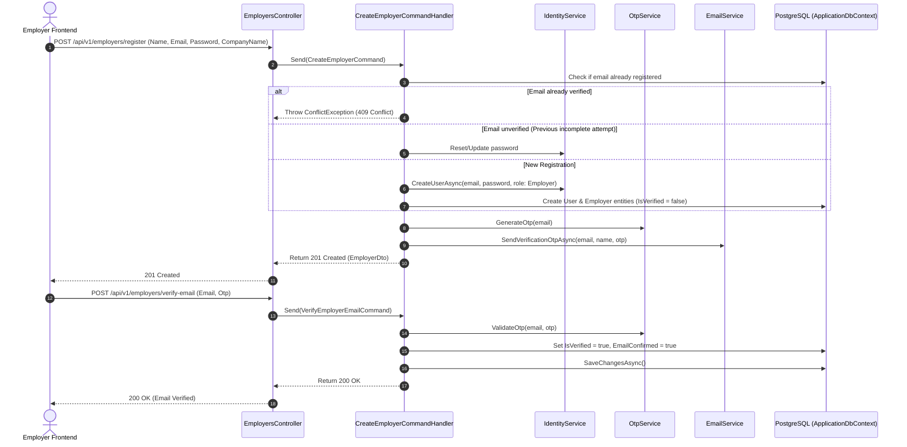
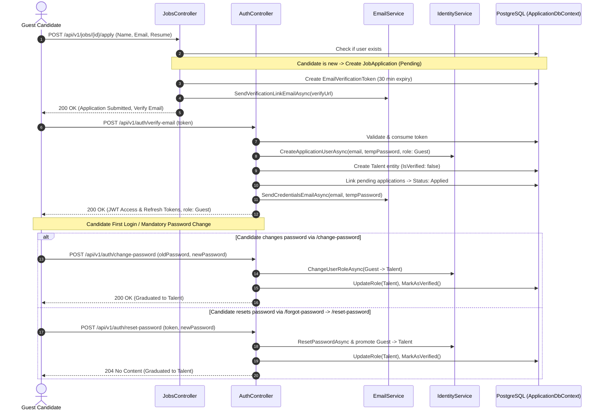

# Authentication & User Lifecycle Flow

The TalentX Backend implements a robust authentication model utilizing **JWT Bearer Tokens**, **ASP.NET Core Identity**, **Google OAuth 2.0 (ID Tokens)**, and **Time-based OTP Email Verification**.

---

## 🏛️ Authentication Strategies

1. **JWT Bearer Tokens (RFC 7519)**:
   - **Access Token**: Short-lived (default 15 minutes), signed with `HMAC-SHA256`. Contains `sub`, `email`, `role`, `jti`, and standard security claims.
   - **Refresh Token**: Stored securely in database table `RefreshTokens` with SHA-256 token hashing, expiry tracking, and revocation support.
2. **Google OAuth 2.0 Integration**:
   - Accepts Google ID token from frontend client.
   - Verified server-side via Google's `GoogleJsonWebSignature` cryptographic validator.
   - Automatically provisions/links Identity user and domain Employer entity.
3. **One-Time Password (OTP) Email Verification**:
   - 6-digit cryptographic random OTP code.
   - Valid for 10 minutes with rate limiting.
   - In `Development` environment, code `000000` is supported for automated testing.

---

## 🔄 Employer Registration & Onboarding Lifecycle

---

## 🎯 Candidate (Talent) Just-In-Time Lifecycle

---

## 🔑 Authentication Endpoints Flow

### 1. User Login (`POST /api/v1/auth/login`)
- Validates credentials via `IdentityService.ValidatePasswordAsync`.
- Generates access token (15 min) and refresh token (7 days) via `TokenService.CreateAsync`.
- Returns `{ userId, email, accessToken, refreshToken }`.
- Frontend redirects `Employer` and `Talent` to `/dashboard`, while `Guest` is routed to `/change-password`.

### 2. Token Refresh (`POST /api/v1/auth/refresh`)
- Accepts valid refresh token string.
- Validates token against database `RefreshTokens` table.
- Rotates refresh token and returns a new access token and fresh refresh token pair.

### 3. Current User (`GET /api/v1/auth/user`)
- Requires `[Authorize]` with `Bearer <token>` header.
- Retrieves caller's `UserId`, `Email`, `Roles`, `HasPassword` flag, and `AuthProviders` list (`["google"]`, `["password"]`, or both).

### 4. Logout (`POST /api/v1/auth/logout`)
- Revokes user's active refresh tokens in database.

### 5. Change Password (`POST /api/v1/auth/change-password`)
- Requires `[Authorize(Roles = "Employer,Talent,Guest")]`.
- Validates current password and sets new password.
- If the caller holds role `Guest`, promotes the user to `Talent` in Identity and Domain tables, marking `IsVerified = true`.

### 6. Add Password for Google Users (`POST /api/v1/auth/add-password`)
- Requires `[Authorize]`.
- Allows Google OAuth users without a password to set a local password.
- Revokes all other active device refresh tokens via `TokenService.RevokeOtherSessionsAsync` while preserving the caller's session via `currentRefreshToken`.

### 7. Forgot Password (`POST /api/v1/auth/forgot-password`)
- Public endpoint (`[AllowAnonymous]`).
- For Google-only accounts, informs the user to sign in with Google.
- For local/password accounts, dispatches a single-use 15-minute secure reset token link via email.

### 8. Reset Password (`POST /api/v1/auth/reset-password`)
- Public endpoint (`[AllowAnonymous]`).
- Validates token and resets user password in ASP.NET Core Identity.
- Revokes all active refresh tokens.
- If user is in role `Guest`, automatically promotes them to `Talent` in Identity and Domain models, marking them verified.

### 9. Guest Application Email Verification (`POST /api/v1/auth/verify-email`)
- Public endpoint (`[AllowAnonymous]`).
- Consumes the candidate's single-use verification token.
- Provisions a new user account with temporary password and role `Guest`.
- Activates all matching pending job applications to `Applied`.
- Returns session tokens for seamless onboarding.
