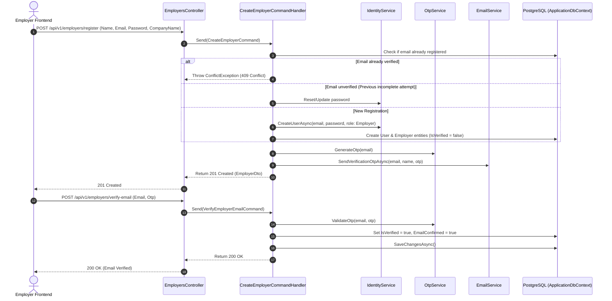

# Authentication & User Lifecycle Flow

The TalentX Backend implements a robust authentication model utilizing **JWT Bearer Tokens**, **ASP.NET Core Identity**, **Google OAuth 2.0 (ID Tokens)**, and **Time-based OTP Email Verification**.

---

## 🏛️ Authentication Strategies

1. **JWT Bearer Tokens (RFC 7519)**:
   - **Access Token**: Short-lived (default 15 minutes), signed with `HMAC-SHA256`. Contains `sub`, `email`, `role`, `jti`, and standard security claims.
   - **Refresh Token**: Stored securely in database table `RefreshTokens` with SHA-256 token hashing, expiry tracking, and revocation support.
2. **Google OAuth 2.0 Integration**:
   - Accepts Google ID token from frontend client.
   - Verified server-side via Google's `GoogleJsonWebSignature` cryptographic validator.
   - Automatically provisions/links Identity user and domain Employer entity.
3. **One-Time Password (OTP) Email Verification**:
   - 6-digit cryptographic random OTP code.
   - Valid for 10 minutes with rate limiting.
   - In `Development` environment, code `000000` is supported for automated testing.

---

## 🔄 Employer Registration & Onboarding Lifecycle

---

## 🔑 Authentication Endpoints Flow

### 1. User Login (`POST /api/v1/auth/login`)
- Validates credentials via `IdentityService.ValidatePasswordAsync`.
- Generates access token (15 min) and refresh token (7 days) via `TokenService.CreateAsync`.
- Returns `{ userId, email, accessToken, refreshToken }`.

### 2. Token Refresh (`POST /api/v1/auth/refresh`)
- Accepts valid refresh token string.
- Validates token against database `RefreshTokens` table.
- Rotates refresh token and returns a new access token and fresh refresh token pair.

### 3. Current User (`GET /api/v1/auth/user`)
- Requires `[Authorize]` with `Bearer <token>` header.
- Retrieves caller's `UserId`, `Email`, and `Roles` via `CurrentUserQuery` and `ICurrentUserService`.

### 4. Logout (`POST /api/v1/auth/logout`)
- Revokes user's active refresh tokens in database.
