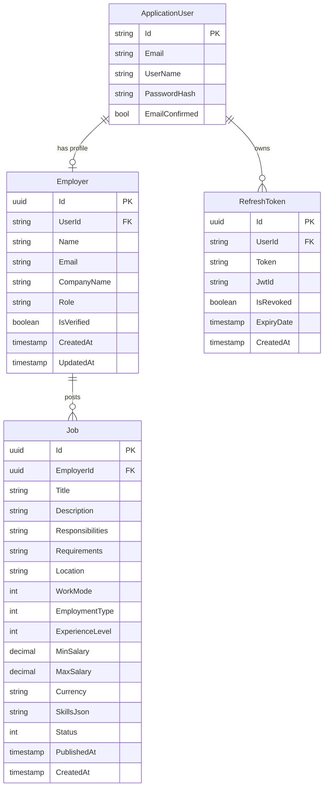

# Database Schema & Entity Relationships

TalentX uses **Entity Framework Core (Code-First)** with **PostgreSQL** (or SQL Server depending on connection string). The persistence layer is encapsulated within `TalentX.Infrastructure`.

---

## 🗄️ Entity Relationship Diagram



---

## 📊 Core Tables

### 1. `Employers` Table
- **`Id`** (`uuid`, PK): Unique employer profile ID.
- **`UserId`** (`varchar(450)`, FK): References ASP.NET Identity `AspNetUsers.Id`.
- **`Name`** (`varchar(120)`, Not Null): Full name of the employer representative.
- **`Email`** (`varchar(255)`, Not Null, Indexed): Company email address.
- **`CompanyName`** (`varchar(200)`, Not Null): Name of the hiring organization.
- **`Role`** (`varchar(50)`, Default `'Employer'`): User role.
- **`IsVerified`** (`boolean`, Default `false`): Verification status (toggled true via OTP or Google OAuth).
- **`CreatedAt`** (`timestamptz`): Registration timestamp in UTC.
- **`UpdatedAt`** (`timestamptz`, Nullable): Last update timestamp in UTC.

### 2. `RefreshTokens` Table
- **`Id`** (`uuid`, PK): Unique token record ID.
- **`UserId`** (`varchar(450)`, FK): Associated user ID.
- **`Token`** (`text`, Indexed): Opaque cryptographically secure random token string.
- **`JwtId`** (`varchar(255)`): Corresponding JWT JTI claim.
- **`IsRevoked`** (`boolean`, Default `false`): Manual revocation flag.
- **`ExpiryDate`** (`timestamptz`): Absolute expiry date.
- **`CreatedAt`** (`timestamptz`): Issuance timestamp.

### 3. `Jobs` Table
- **`Id`** (`uuid`, PK): Unique Job identifier.
- **`EmployerId`** (`uuid`, FK, Nullable): Associated Employer identifier.
- **`Title`** (`varchar(200)`, Not Null): Position title.
- **`Description`** (`text`, Not Null): Job description.
- **`Status`** (`integer`): `0 = Draft`, `1 = Published`, `2 = Closed`, `3 = Archived`.
- **`WorkMode`** (`integer`): `0 = OnSite`, `1 = Hybrid`, `2 = Remote`.
- **`EmploymentType`** (`integer`): `0 = FullTime`, `1 = PartTime`, `2 = Contract`, `3 = Freelance`.
- **`ExperienceLevel`** (`integer`): `0 = EntryLevel`, `1 = MidLevel`, `2 = Senior`, `3 = Lead`, `4 = Executive`.

---

## ⚙️ Migrations & Database Commands

```bash
# Add a new migration (run from talentx2026q3.backend root)
dotnet ef migrations add <MigrationName> -p src/TalentX.Infrastructure -s src/TalentX.Api

# Update database to latest migration
dotnet ef database update -p src/TalentX.Infrastructure -s src/TalentX.Api

# Remove last unapplied migration
dotnet ef migrations remove -p src/TalentX.Infrastructure -s src/TalentX.Api
```
