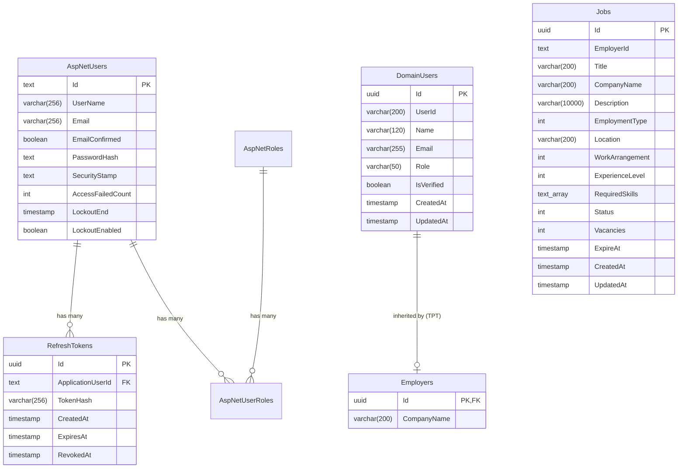

# Database Schema & Entity Relationships

The TalentX database is hosted on **PostgreSQL 16+** and managed via **Entity Framework Core 10 (Code-First)** with Table-Per-Type (TPT) inheritance mapping.

---

## 🏛️ Entity Relationship Diagram

---

## 🗄️ Database Tables Specification

### 1. `DomainUsers` (Table-per-Type Base Table)
| Column | Type | Constraints | Description |
| :--- | :--- | :--- | :--- |
| `Id` | `uuid` | `PRIMARY KEY` | Domain unique identifier |
| `UserId` | `varchar(200)` | `NOT NULL` | Linked Identity User identifier |
| `Name` | `varchar(120)` | `NOT NULL` | Full display name |
| `Email` | `varchar(255)` | `NOT NULL` | Primary email address |
| `Role` | `varchar(50)` | `NOT NULL` | User role (`Employer`, `Talent`) |
| `IsVerified` | `boolean` | `NOT NULL, DEFAULT false` | Email verification status |
| `CreatedAt` | `timestamptz` | `NOT NULL` | Account creation timestamp (UTC) |
| `UpdatedAt` | `timestamptz` | `NULL` | Last modification timestamp (UTC) |

---

### 2. `Employers` (Table-per-Type Derived Table)
| Column | Type | Constraints | Description |
| :--- | :--- | :--- | :--- |
| `Id` | `uuid` | `PRIMARY KEY, FK -> DomainUsers(Id)` | Shared identifier with `DomainUsers` |
| `CompanyName` | `varchar(200)` | `NOT NULL` | Employer company or organization name |

---

### 3. `Jobs`
| Column | Type | Constraints | Description |
| :--- | :--- | :--- | :--- |
| `Id` | `uuid` | `PRIMARY KEY` | Job listing unique identifier |
| `EmployerId` | `text` | `NOT NULL, INDEXED` | Owning employer's user id (not a DB-level FK — resolved via `ICurrentUserService`) |
| `Title` | `varchar(200)` | `NOT NULL` | Job title |
| `CompanyName` | `varchar(200)` | `NOT NULL` | Company or organization name shown on the listing |
| `Description` | `varchar(10000)` | `NOT NULL` | Full job description |
| `EmploymentType` | `int` | `NOT NULL` | Enum: `FullTime`, `PartTime`, `Contract`, `Internship` |
| `Location` | `varchar(200)` | `NOT NULL` | Job location |
| `WorkArrangement` | `int` | `NOT NULL` | Enum: `OnSite`, `Remote`, `Hybrid` |
| `ExperienceLevel` | `int` | `NOT NULL` | Enum: `EntryLevel`, `MidLevel`, `SeniorLevel`, `Lead`, `Executive` |
| `RequiredSkills` | `text[]` | `NOT NULL` | Primitive collection, deduplicated case-insensitively |
| `Status` | `int` | `NOT NULL` | Enum: `Draft`, `Published`, `Closed` |
| `Vacancies` | `int` | `NOT NULL` | Number of open positions |
| `ExpireAt` | `timestamptz` | `NOT NULL` | Listing expiry timestamp (UTC) |
| `CreatedAt` | `timestamptz` | `NOT NULL` | Creation timestamp (UTC) |
| `UpdatedAt` | `timestamptz` | `NULL` | Last modification timestamp (UTC) |

---

### 4. `RefreshTokens`
| Column | Type | Constraints | Description |
| :--- | :--- | :--- | :--- |
| `Id` | `uuid` | `PRIMARY KEY` | Token unique identifier |
| `ApplicationUserId`| `varchar(256)` | `NOT NULL, FK -> AspNetUsers(Id)` | Owner user ID |
| `TokenHash` | `varchar(256)` | `NOT NULL, UNIQUE` | SHA-256 hash of refresh token |
| `CreatedAt` | `timestamptz` | `NOT NULL, DEFAULT CURRENT_TIMESTAMP` | Token creation timestamp |
| `ExpiresAt` | `timestamptz` | `NOT NULL` | Token expiry timestamp (7 days) |
| `RevokedAt` | `timestamptz` | `NULL` | Revocation timestamp if logged out |

---

### 5. `Talents` (Table-per-Type Derived Table)
| Column | Type | Constraints | Description |
| :--- | :--- | :--- | :--- |
| `Id` | `uuid` | `PRIMARY KEY, FK -> DomainUsers(Id)` | Shared identifier with `DomainUsers` |
| `ProfilePictureStorageKey` | `varchar(500)` | `NULL` | Storage key for profile picture |
| `Tagline` | `varchar(160)` | `NULL` | Professional headline |
| `ShortBio` | `varchar(1000)` | `NULL` | Brief biography |
| `Location` | `varchar(200)` | `NULL` | Geographic location |
| `Phone` | `varchar(40)` | `NULL` | Contact phone number |
| `LinkedInUrl` | `varchar(500)` | `NULL` | LinkedIn profile link |
| `AdditionalUrls` | `text` | `NOT NULL` | JSON serialized list of external links |
| `VideoIntroStorageKey` | `varchar(500)` | `NULL` | Storage key for video introduction |
| `TotalYearsExperience` | `numeric(4,1)` | `NULL` | Years of industry experience |
| `ExpectedSalary` | `numeric(12,2)` | `NULL` | Target compensation |
| `SkillPropositions` | `text` | `NOT NULL` | JSON serialized value propositions |
| `TechnicalSkills` | `text` | `NOT NULL` | JSON serialized list of technical skills |
| `SoftSkills` | `text` | `NOT NULL` | JSON serialized list of soft skills |
| `ToolsAndPlatforms` | `text` | `NOT NULL` | JSON serialized list of tools and platforms |

---

### 6. `JobApplications`
| Column | Type | Constraints | Description |
| :--- | :--- | :--- | :--- |
| `Id` | `uuid` | `PRIMARY KEY` | Application unique identifier |
| `JobId` | `uuid` | `NOT NULL, FK -> Jobs(Id)` | Associated job posting |
| `ApplicantName` | `varchar(120)` | `NOT NULL` | Candidate name |
| `ApplicantEmail` | `varchar(255)` | `NOT NULL` | Candidate contact email |
| `TalentUserId` | `varchar(200)` | `NULL` | Linked Identity UserId (populated on verification) |
| `ResumeDownloadUrl` | `varchar(500)` | `NOT NULL` | Storage path/URL for resume file |
| `CoverLetter` | `varchar(5000)` | `NULL` | Optional cover letter text |
| `Status` | `varchar(50)` | `NOT NULL` | Enum: `PendingEmailVerification`, `Applied`, `Reviewing`, `Accepted`, `Rejected` |
| `ExpectedSalary` | `numeric(12,2)` | `NULL` | Salary expectation at time of application |
| `TotalYearsExperience`| `numeric(4,1)` | `NULL` | Experience level at time of application |
| `Location` | `varchar(200)` | `NULL` | Candidate location |
| `AiMatchScore` | `numeric(5,2)` | `NULL` | AI-computed job suitability match score |
| `CreatedAt` | `timestamptz` | `NOT NULL` | Submission timestamp (UTC) |
| `UpdatedAt` | `timestamptz` | `NULL` | Last status update timestamp (UTC) |

---

### 7. `EmailVerificationTokens`
| Column | Type | Constraints | Description |
| :--- | :--- | :--- | :--- |
| `Id` | `uuid` | `PRIMARY KEY` | Verification token identifier |
| `Token` | `varchar(256)` | `NOT NULL, UNIQUE` | Cryptographic verification token |
| `ApplicantEmail` | `varchar(255)` | `NOT NULL` | Associated applicant email |
| `JobApplicationId` | `uuid` | `NOT NULL` | Linked job application id |
| `ExpiresAt` | `timestamptz` | `NOT NULL` | Expiration timestamp (30 minutes) |
| `IsConsumed` | `boolean` | `NOT NULL, DEFAULT false`| Whether token has already been used |
| `ConsumedAt` | `timestamptz` | `NULL` | Consumption timestamp |
| `CreatedAt` | `timestamptz` | `NOT NULL` | Creation timestamp |

---

### 8. `WorkExperiences`
| Column | Type | Constraints | Description |
| :--- | :--- | :--- | :--- |
| `Id` | `uuid` | `PRIMARY KEY` | Experience record identifier |
| `UserId` | `varchar(200)` | `NOT NULL, INDEXED` | Owning talent user ID |
| `CompanyName` | `varchar(200)` | `NOT NULL` | Employer company name |
| `JobTitle` | `varchar(200)` | `NOT NULL` | Position title |
| `StartDate` | `varchar(50)` | `NULL` | Employment start date string |
| `EndDate` | `varchar(50)` | `NULL` | Employment end date string |
| `IsCurrent` | `boolean` | `NOT NULL, DEFAULT false`| Whether position is current |
| `Description` | `varchar(2000)` | `NULL` | Job responsibilities & achievements |
| `CreatedAt` | `timestamptz` | `NOT NULL` | Creation timestamp |
| `UpdatedAt` | `timestamptz` | `NULL` | Modification timestamp |

---

### 9. `Educations`
| Column | Type | Constraints | Description |
| :--- | :--- | :--- | :--- |
| `Id` | `uuid` | `PRIMARY KEY` | Education record identifier |
| `UserId` | `varchar(200)` | `NOT NULL, INDEXED` | Owning talent user ID |
| `Institution` | `varchar(200)` | `NOT NULL` | University or institution name |
| `Degree` | `varchar(200)` | `NULL` | Degree earned |
| `FieldOfStudy` | `varchar(200)` | `NULL` | Major or specialization |
| `StartYear` | `int` | `NULL` | Beginning year |
| `EndYear` | `int` | `NULL` | Completion year |
| `IsCurrent` | `boolean` | `NOT NULL, DEFAULT false`| Ongoing degree program flag |
| `Description` | `varchar(1000)` | `NULL` | Honors or activities |
| `CreatedAt` | `timestamptz` | `NOT NULL` | Creation timestamp |
| `UpdatedAt` | `timestamptz` | `NULL` | Modification timestamp |

---

### 10. `Resumes`
| Column | Type | Constraints | Description |
| :--- | :--- | :--- | :--- |
| `Id` | `uuid` | `PRIMARY KEY` | Resume record identifier |
| `UserId` | `varchar(200)` | `NOT NULL, INDEXED` | Owning talent user ID (up to 5 resumes per user) |
| `StorageKey` | `varchar(500)` | `NOT NULL` | Storage service key |
| `OriginalFileName` | `varchar(255)` | `NOT NULL` | Sanitized original filename |
| `DisplayName` | `varchar(100)` | `NOT NULL` | User-facing label (defaults to the file name) |
| `ContentType` | `varchar(100)` | `NOT NULL` | MIME content type (PDF/DOCX) |
| `SizeBytes` | `bigint` | `NOT NULL` | File size in bytes |
| `IsDefault` | `boolean` | `NOT NULL, DEFAULT false` | Whether the resume is used by apply prefill |
| `UploadedAt` | `timestamptz` | `NOT NULL` | Upload timestamp |
| `CreatedAt` | `timestamptz` | `NOT NULL` | Creation timestamp |
| `UpdatedAt` | `timestamptz` | `NULL` | Modification timestamp |

The 5-resume cap and the single-default rule are enforced in application handlers; the
unique index that previously limited talents to one resume was dropped in the
`AddResumeLibrary` migration (existing rows were backfilled as the default resume).

