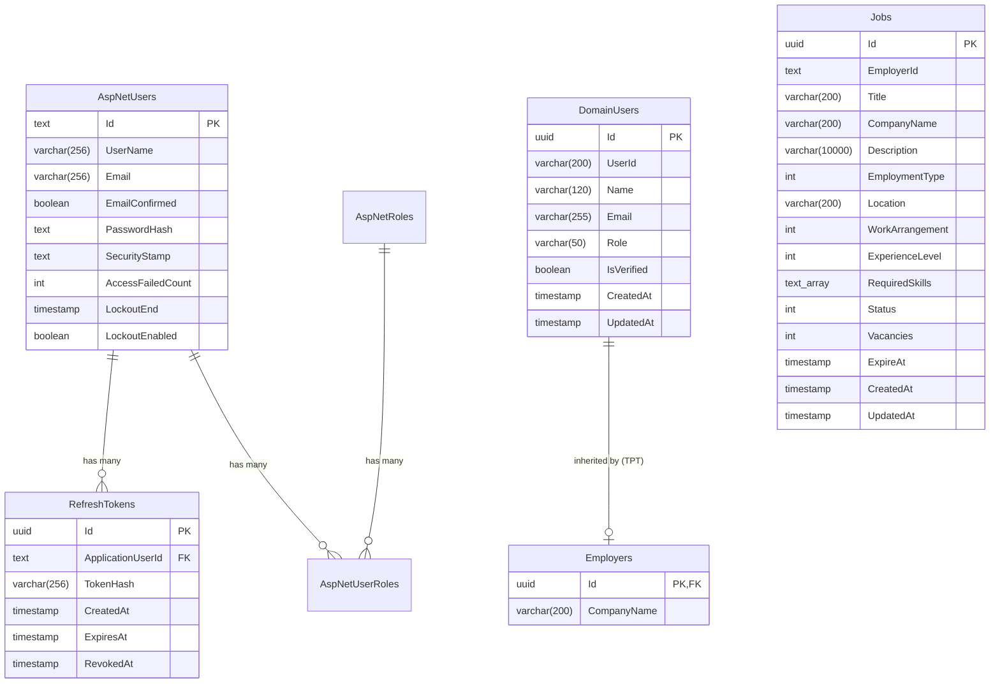

# Database Schema & Entity Relationships

The TalentX database is hosted on **PostgreSQL 16+** and managed via **Entity Framework Core 10 (Code-First)** with Table-Per-Type (TPT) inheritance mapping.

---

## 🏛️ Entity Relationship Diagram

---

## 🗄️ Database Tables Specification

### 1. `DomainUsers` (Table-per-Type Base Table)
| Column | Type | Constraints | Description |
| :--- | :--- | :--- | :--- |
| `Id` | `uuid` | `PRIMARY KEY` | Domain unique identifier |
| `UserId` | `varchar(200)` | `NOT NULL` | Linked Identity User identifier |
| `Name` | `varchar(120)` | `NOT NULL` | Full display name |
| `Email` | `varchar(255)` | `NOT NULL` | Primary email address |
| `Role` | `varchar(50)` | `NOT NULL` | User role (`Employer`, `Talent`) |
| `IsVerified` | `boolean` | `NOT NULL, DEFAULT false` | Email verification status |
| `CreatedAt` | `timestamptz` | `NOT NULL` | Account creation timestamp (UTC) |
| `UpdatedAt` | `timestamptz` | `NULL` | Last modification timestamp (UTC) |

---

### 2. `Employers` (Table-per-Type Derived Table)
| Column | Type | Constraints | Description |
| :--- | :--- | :--- | :--- |
| `Id` | `uuid` | `PRIMARY KEY, FK -> DomainUsers(Id)` | Shared identifier with `DomainUsers` |
| `CompanyName` | `varchar(200)` | `NOT NULL` | Employer company or organization name |

---

### 3. `Jobs`
| Column | Type | Constraints | Description |
| :--- | :--- | :--- | :--- |
| `Id` | `uuid` | `PRIMARY KEY` | Job listing unique identifier |
| `EmployerId` | `text` | `NOT NULL, INDEXED` | Owning employer's user id (not a DB-level FK — resolved via `ICurrentUserService`) |
| `Title` | `varchar(200)` | `NOT NULL` | Job title |
| `CompanyName` | `varchar(200)` | `NOT NULL` | Company or organization name shown on the listing |
| `Description` | `varchar(10000)` | `NOT NULL` | Full job description |
| `EmploymentType` | `int` | `NOT NULL` | Enum: `FullTime`, `PartTime`, `Contract`, `Internship` |
| `Location` | `varchar(200)` | `NOT NULL` | Job location |
| `WorkArrangement` | `int` | `NOT NULL` | Enum: `OnSite`, `Remote`, `Hybrid` |
| `ExperienceLevel` | `int` | `NOT NULL` | Enum: `EntryLevel`, `MidLevel`, `SeniorLevel`, `Lead`, `Executive` |
| `RequiredSkills` | `text[]` | `NOT NULL` | Primitive collection, deduplicated case-insensitively |
| `Status` | `int` | `NOT NULL` | Enum: `Draft`, `Published`, `Closed` |
| `Vacancies` | `int` | `NOT NULL` | Number of open positions |
| `ExpireAt` | `timestamptz` | `NOT NULL` | Listing expiry timestamp (UTC) |
| `CreatedAt` | `timestamptz` | `NOT NULL` | Creation timestamp (UTC) |
| `UpdatedAt` | `timestamptz` | `NULL` | Last modification timestamp (UTC) |

---

### 4. `RefreshTokens`
| Column | Type | Constraints | Description |
| :--- | :--- | :--- | :--- |
| `Id` | `uuid` | `PRIMARY KEY` | Token unique identifier |
| `ApplicationUserId`| `varchar(256)` | `NOT NULL, FK -> AspNetUsers(Id)` | Owner user ID |
| `TokenHash` | `varchar(256)` | `NOT NULL, UNIQUE` | SHA-256 hash of refresh token |
| `CreatedAt` | `timestamptz` | `NOT NULL, DEFAULT CURRENT_TIMESTAMP` | Token creation timestamp |
| `ExpiresAt` | `timestamptz` | `NOT NULL` | Token expiry timestamp (7 days) |
| `RevokedAt` | `timestamptz` | `NULL` | Revocation timestamp if logged out |
