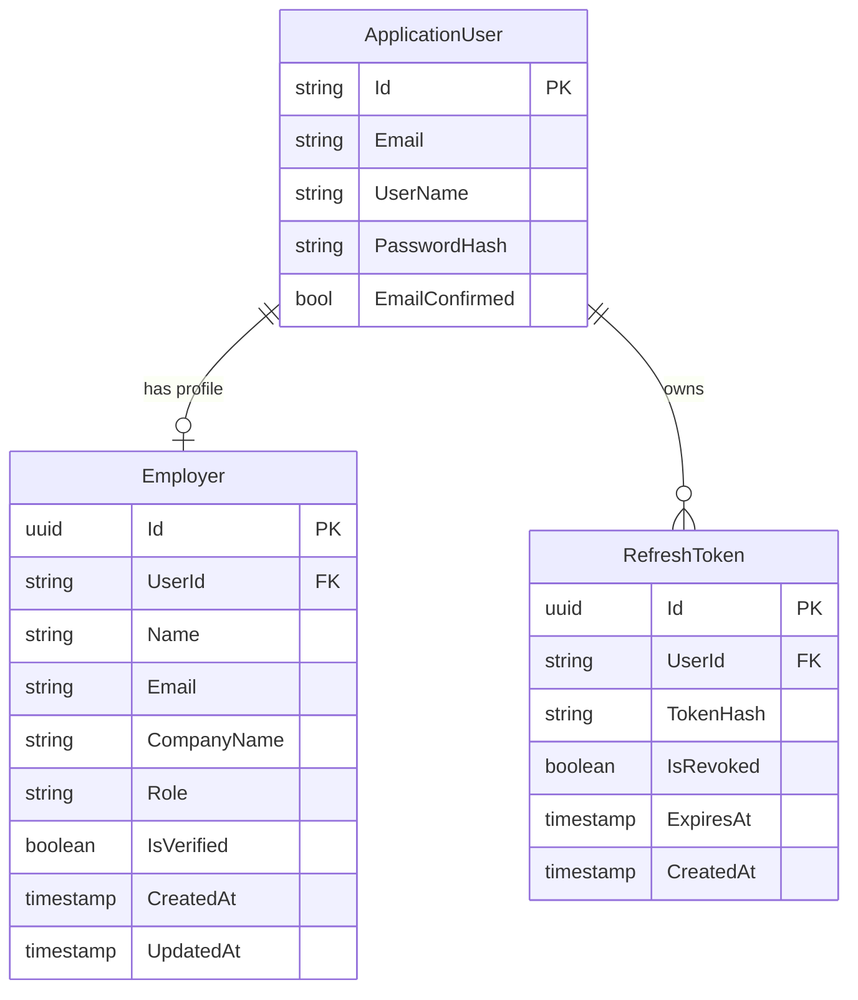

# Database Schema & Entity Relationships

TalentX uses **Entity Framework Core (Code-First)** with **PostgreSQL**. The persistence layer is encapsulated within `TalentX.Infrastructure` with migrations managed by `TalentX.Migrations.PostgreSQL`.

---

## 🗄️ Entity Relationship Diagram



---

## 📊 Core Tables

### 1. `DomainUsers` / `Employers` Tables (TPT Inheritance)
- **`Id`** (`uuid`, PK): Unique domain entity identifier.
- **`UserId`** (`varchar(200)`, Not Null): Unique ASP.NET Identity User ID.
- **`Name`** (`varchar(120)`, Not Null): Full name.
- **`Email`** (`varchar(255)`, Not Null, Indexed): Email address.
- **`CompanyName`** (`varchar(200)`, Not Null): Company name (stored on `Employers` table).
- **`Role`** (`varchar(50)`, Default `'Employer'`): User role (`Employer` or `Talent`).
- **`IsVerified`** (`boolean`, Default `false`): Verification status (toggled true via OTP or Google OAuth).
- **`CreatedAt`** (`timestamptz`): Creation timestamp in UTC.
- **`UpdatedAt`** (`timestamptz`, Nullable): Last update timestamp in UTC.

### 2. `RefreshTokens` Table
- **`Id`** (`uuid`, PK): Unique token record ID.
- **`ApplicationUserId`** (`varchar(450)`, FK): Associated Identity user ID.
- **`TokenHash`** (`text`, Indexed): SHA256 hashed refresh token string.
- **`RevokedAt`** (`timestamptz`, Nullable): Revocation timestamp if revoked.
- **`ExpiresAt`** (`timestamptz`): Absolute expiry date.
- **`CreatedAt`** (`timestamptz`): Issuance timestamp.

---

## ⚙️ Migrations & Database Commands

```bash
# Add a new migration (run from talentx2026q3.backend root)
dotnet ef migrations add <MigrationName> -p src/TalentX.Migrations.PostgreSQL -s src/TalentX.Api

# Update database to latest migration
dotnet ef database update -p src/TalentX.Migrations.PostgreSQL -s src/TalentX.Api
```
