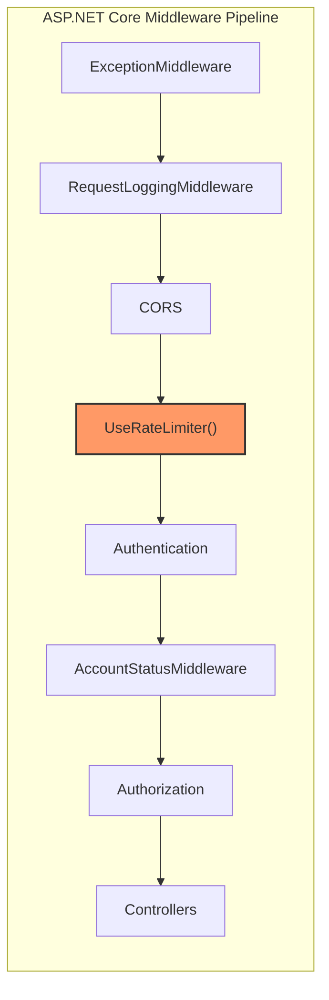

# Rate Limiting for Sensitive TalentX Endpoints

## Goal
Add per-endpoint rate limiting to 6 sensitive API endpoints using ASP.NET Core's **built-in rate limiting middleware** (`Microsoft.AspNetCore.RateLimiting`), which ships with the .NET 10 runtime — **no extra NuGet packages required**.

Each endpoint gets its own named rate limiting policy with limits tuned to its risk profile (anonymous abuse, AI cost, file upload cost, etc.).

## User Review Required

> [!IMPORTANT]
> **Rate limit values** — I've proposed default limits below based on each endpoint's risk profile. Please review and adjust before I implement.

| # | Endpoint | Policy Name | Strategy | Proposed Limit | Window | Key |
|---|----------|-------------|----------|----------------|--------|-----|
| 1 | `POST /api/v1/auth/verify-email` | `VerifyEmail` | Fixed Window | **5 req** | 1 min | IP address |
| 2 | `POST /api/v1/jobs/{id}/apply` | `JobApply` | Fixed Window | **5 req** | 1 min | IP address |
| 3 | `POST /api/v1/jobs/application-resumes` | `UploadResume` | Fixed Window | **10 req** | 1 min | User ID (authenticated) |
| 4 | `POST /api/v1/employers/jobs/{jobId}/match` | `RunMatching` | Fixed Window | **3 req** | 1 min | User ID (authenticated) |
| 5 | `GET /api/v1/employers/jobs/{jobId}/candidates` | `GetCandidates` | Fixed Window | **20 req** | 1 min | User ID (authenticated) |
| 6 | `GET /api/v1/employers/candidates/{id}/summary` | `CandidateSummary` | Fixed Window | **15 req** | 1 min | User ID (authenticated) |

**Rationale for key selection:**
- Endpoints 1 & 2 are `[AllowAnonymous]` — keying by **IP** is the only option and protects against brute-force/spam.
- Endpoints 3–6 require authentication — keying by **authenticated User ID** is more precise and avoids shared-IP collisions (offices, VPNs).

> [!WARNING]
> **429 response format** — The built-in middleware returns a plain `429 Too Many Requests` with a `Retry-After` header. I'll add a custom `OnRejected` handler that returns a JSON body matching your existing `ErrorResponseDto` pattern so the frontend can handle it consistently.

## Open Questions

> [!IMPORTANT]
> 1. **Are the proposed limits acceptable?** Particularly for `RunMatching` (3/min) — this triggers AI evaluation which is expensive. Should it be even lower (e.g., 1/min)?
> 2. **Queue permits?** The fixed window limiter supports a `QueueLimit` (requests that wait instead of being rejected). Default is **0** (reject immediately). Do you want any endpoints to queue?
> 3. **Global fallback?** Do you want a global rate limit on all endpoints as a safety net (e.g., 100 req/min/IP), or only these 6 targeted ones?

---

## Proposed Changes

### Architecture Overview



> [!NOTE]
> Rate limiter is placed **after CORS** (so preflight OPTIONS requests aren't rate-limited) and **before Authentication** so that anonymous endpoints like `verify-email` and `apply` are protected before auth runs. For authenticated endpoints, the rate limiter uses a partition key function that reads the user claim from `HttpContext.User` — this works because the `[EnableRateLimiting]` attribute is evaluated at the **endpoint** level (after auth), even though the middleware is registered earlier in the pipeline.

---

### Infrastructure Layer — Rate Limiting Registration

#### [NEW] `RateLimiting/RateLimitingStartup.cs`

New file in `TalentX.Infrastructure/RateLimiting/` that registers all rate limiting policies:

```csharp
using System.Security.Claims;
using System.Threading.RateLimiting;
using Microsoft.AspNetCore.Builder;
using Microsoft.AspNetCore.Http;
using Microsoft.Extensions.DependencyInjection;

namespace TalentX.Infrastructure.RateLimiting;

public static class RateLimitingStartup
{
    public static IServiceCollection AddRateLimiting(this IServiceCollection services)
    {
        services.AddRateLimiter(options =>
        {
            // ── Custom 429 JSON response ──
            options.OnRejected = async (context, cancellationToken) =>
            {
                context.HttpContext.Response.StatusCode = StatusCodes.Status429TooManyRequests;
                context.HttpContext.Response.ContentType = "application/json";

                var retryAfter = context.Lease.TryGetMetadata(
                    MetadataName.RetryAfter, out var retryAfterValue)
                    ? retryAfterValue
                    : TimeSpan.FromSeconds(60);

                context.HttpContext.Response.Headers.RetryAfter =
                    ((int)retryAfter.TotalSeconds).ToString();

                await context.HttpContext.Response.WriteAsJsonAsync(new
                {
                    User = new { Message = "Too many requests. Please try again later." },
                    Dev = new
                    {
                        Message = "Rate limit exceeded.",
                        Details = $"Retry after {(int)retryAfter.TotalSeconds} seconds.",
                        ExceptionType = "RateLimitExceeded"
                    }
                }, cancellationToken);
            };

            // ── Policy: VerifyEmail (Anonymous, IP-keyed) ──
            options.AddPolicy("VerifyEmail", context =>
                RateLimitPartition.GetFixedWindowLimiter(
                    partitionKey: GetClientIp(context),
                    factory: _ => new FixedWindowRateLimiterOptions
                    {
                        PermitLimit = 5,
                        Window = TimeSpan.FromMinutes(1),
                        QueueLimit = 0
                    }));

            // ── Policy: JobApply (Anonymous, IP-keyed) ──
            options.AddPolicy("JobApply", context =>
                RateLimitPartition.GetFixedWindowLimiter(
                    partitionKey: GetClientIp(context),
                    factory: _ => new FixedWindowRateLimiterOptions
                    {
                        PermitLimit = 5,
                        Window = TimeSpan.FromMinutes(1),
                        QueueLimit = 0
                    }));

            // ── Policy: UploadResume (Authenticated, User-keyed) ──
            options.AddPolicy("UploadResume", context =>
                RateLimitPartition.GetFixedWindowLimiter(
                    partitionKey: GetUserId(context),
                    factory: _ => new FixedWindowRateLimiterOptions
                    {
                        PermitLimit = 10,
                        Window = TimeSpan.FromMinutes(1),
                        QueueLimit = 0
                    }));

            // ── Policy: RunMatching (Authenticated, User-keyed) ──
            options.AddPolicy("RunMatching", context =>
                RateLimitPartition.GetFixedWindowLimiter(
                    partitionKey: GetUserId(context),
                    factory: _ => new FixedWindowRateLimiterOptions
                    {
                        PermitLimit = 3,
                        Window = TimeSpan.FromMinutes(1),
                        QueueLimit = 0
                    }));

            // ── Policy: GetCandidates (Authenticated, User-keyed) ──
            options.AddPolicy("GetCandidates", context =>
                RateLimitPartition.GetFixedWindowLimiter(
                    partitionKey: GetUserId(context),
                    factory: _ => new FixedWindowRateLimiterOptions
                    {
                        PermitLimit = 20,
                        Window = TimeSpan.FromMinutes(1),
                        QueueLimit = 0
                    }));

            // ── Policy: CandidateSummary (Authenticated, User-keyed) ──
            options.AddPolicy("CandidateSummary", context =>
                RateLimitPartition.GetFixedWindowLimiter(
                    partitionKey: GetUserId(context),
                    factory: _ => new FixedWindowRateLimiterOptions
                    {
                        PermitLimit = 15,
                        Window = TimeSpan.FromMinutes(1),
                        QueueLimit = 0
                    }));
        });

        return services;
    }

    public static IApplicationBuilder UseRateLimiting(
        this IApplicationBuilder app)
    {
        app.UseRateLimiter();
        return app;
    }

    // ── Helpers ──

    private static string GetClientIp(HttpContext context) =>
        context.Connection.RemoteIpAddress?.ToString() ?? "unknown";

    private static string GetUserId(HttpContext context) =>
        context.User.FindFirstValue(ClaimTypes.NameIdentifier) ?? GetClientIp(context);
}
```

> [!TIP]
> The `GetUserId` helper **falls back to IP** if the user claim is not yet populated. This means the rate limiter still works even if auth hasn't run yet for some edge case.

---

### Infrastructure Layer — Wire-up

#### [MODIFY] `InfrastructureStartup.cs`

Add `services.AddRateLimiting()` to the DI registration:

```diff
+ using TalentX.Infrastructure.RateLimiting;

  public static IServiceCollection AddInfrastructure(
      this IServiceCollection services,
      IConfiguration configuration)
  {
      services.AddPersistence(configuration);
      services.AddIdentityServices(configuration);
      services.AddFileStorage(configuration);
      services.AddExtractionServices(configuration);
      services.AddRealtime();
+     services.AddRateLimiting();

      return services;
  }
```

---

### API Layer — Middleware Pipeline

#### [MODIFY] `Program.cs`

Insert `UseRateLimiter()` between CORS and Authentication:

```diff
+ using TalentX.Infrastructure.RateLimiting;

  // 7. Middlewares & Routing
  app.UseInfrastructureMiddlewares();
  app.UseCors(CorsPolicyName);
+ app.UseRateLimiting();
  app.UseAuthentication();
  app.UseMiddleware<AccountStatusMiddleware>();
  app.UseAuthorization();
  app.MapControllers();
  app.MapNotificationHub();
```

---

### Controller Layer — Apply `[EnableRateLimiting]` Attributes

#### [MODIFY] [AuthController.cs](file:///home/rohan-sinha/Projects/TalentX/backend/src/TalentX.API/Controllers/Auth/AuthController.cs#L131-L145)

```diff
+ using Microsoft.AspNetCore.RateLimiting;

  [AllowAnonymous]
  [HttpPost("verify-email")]
+ [EnableRateLimiting("VerifyEmail")]
  public async Task<IActionResult> VerifyGuestEmail(VerifyGuestEmailCommand command)
```

#### [MODIFY] [JobsController.cs](file:///home/rohan-sinha/Projects/TalentX/backend/src/TalentX.API/Controllers/Jobs/JobsController.cs#L133-L158)

```diff
+ using Microsoft.AspNetCore.RateLimiting;

  [HttpPost("{id:guid}/apply")]
  [AllowAnonymous]
  [Consumes("multipart/form-data")]
+ [EnableRateLimiting("JobApply")]
  public async Task<IActionResult> Apply(...)
```

#### [MODIFY] [JobApplicationsController.cs](file:///home/rohan-sinha/Projects/TalentX/backend/src/TalentX.API/Controllers/JobApplications/JobApplicationsController.cs#L36-L46)

```diff
+ using Microsoft.AspNetCore.RateLimiting;

  [HttpPost("application-resumes")]
  [Consumes("multipart/form-data")]
  [RequestSizeLimit(5 * 1024 * 1024)]
+ [EnableRateLimiting("UploadResume")]
  public async Task<IActionResult> UploadApplicationResume(...)
```

#### [MODIFY] [EmployerTalentMatchingController.cs](file:///home/rohan-sinha/Projects/TalentX/backend/src/TalentX.API/Controllers/Employers/EmployerTalentMatchingController.cs)

Three methods in the same controller:

```diff
+ using Microsoft.AspNetCore.RateLimiting;

  [HttpPost("jobs/{jobId:guid}/match")]
+ [EnableRateLimiting("RunMatching")]
  public async Task<IActionResult> RunMatching(...)

  [HttpGet("jobs/{jobId:guid}/candidates")]
+ [EnableRateLimiting("GetCandidates")]
  public async Task<IActionResult> GetMatchedCandidates(...)

  [HttpGet("candidates/{id}/summary")]
+ [EnableRateLimiting("CandidateSummary")]
  public async Task<IActionResult> GetCandidateSummary(...)
```

---

## Files Changed Summary

| Action | File | Description |
|--------|------|-------------|
| **NEW** | `TalentX.Infrastructure/RateLimiting/RateLimitingStartup.cs` | All 6 rate limiting policies + custom 429 JSON response |
| MODIFY | `TalentX.Infrastructure/InfrastructureStartup.cs` | Wire up `AddRateLimiting()` |
| MODIFY | `TalentX.API/Program.cs` | Add `app.UseRateLimiting()` to pipeline |
| MODIFY | `TalentX.API/Controllers/Auth/AuthController.cs` | `[EnableRateLimiting("VerifyEmail")]` |
| MODIFY | `TalentX.API/Controllers/Jobs/JobsController.cs` | `[EnableRateLimiting("JobApply")]` |
| MODIFY | `TalentX.API/Controllers/JobApplications/JobApplicationsController.cs` | `[EnableRateLimiting("UploadResume")]` |
| MODIFY | `TalentX.API/Controllers/Employers/EmployerTalentMatchingController.cs` | 3 attributes added |

---

## Verification Plan

### Automated Tests

```bash
cd /home/rohan-sinha/Projects/TalentX/backend
dotnet build
dotnet test
```

The build will verify:
- All `[EnableRateLimiting]` attributes reference valid policy names
- The rate limiting middleware is correctly wired
- No existing tests break

### Manual Verification

1. **Start the server** and send 6 rapid requests to `POST /api/v1/auth/verify-email` — the 6th request should return `429` with the JSON body:
   ```json
   {
     "User": { "Message": "Too many requests. Please try again later." },
     "Dev": { "Message": "Rate limit exceeded.", "Details": "Retry after 60 seconds.", "ExceptionType": "RateLimitExceeded" }
   }
   ```
2. Verify the `Retry-After` header is present in the 429 response.
3. Verify that requests **within** the limit still succeed with normal responses.
4. For authenticated endpoints, verify that different users have **independent** rate limit counters.
